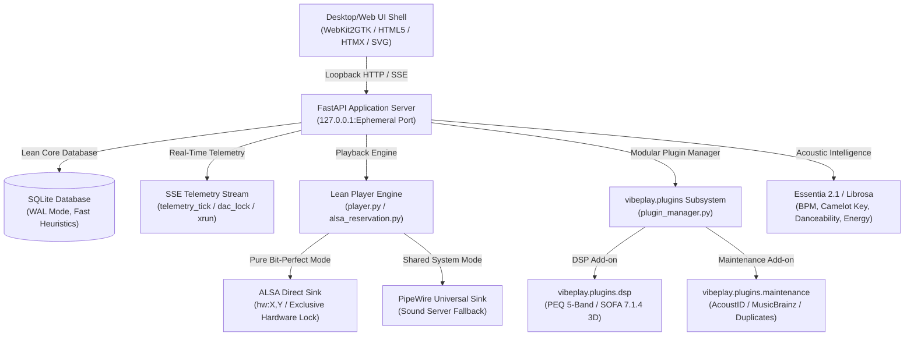

# vibeplay

[](https://github.com/defiqantcoder/vibeplay/actions)


> **Precision Audiophile Music Console & Lo-Fi Lounge for Linux (Ubuntu 24.04 LTS)**  
> Bit-perfect ALSA hardware reservation, dynamic DAC detection, 15 tactile Lo-Fi Lounge screens, modular add-on architecture, Camelot harmonic key mixing, and local natural-language smart playlists.

---

## 📖 Table of Contents

- [About](#-about)
- [Core Features](#-core-features)
- [UI & Views](#️-ui--views-ubuntu-app--web-app)
- [Prerequisites](#-prerequisites)
- [Installation](#-installation)
- [Usage](#-usage)
  - [CLI Reference](#cli-reference)
  - [Keyboard Shortcuts](#keyboard-shortcuts-desktop--web-app)
- [Architecture Overview](#-architecture-overview)
- [Development & Testing](#-development--testing)
- [License](#-license)

---

## 🎧 About

**vibeplay** is a local music library scanner, metadata enricher, and vibe-based smart playlist generator designed for audiophiles on Linux. Built with a focus on bit-perfect audio delivery, it directly interfaces with ALSA (\`hw:\`) to bypass OS resampling while providing a rich, responsive interface via a FastAPI backend and a WebKit2GTK frontend.

It can be run as a standalone desktop application (\`Ubuntu App\`), a browser-based web application (\`Web App\`), or completely headlessly via its comprehensive command-line interface (\`CLI\`). The Web App and Ubuntu App are functionally identical, sharing the same views and components.

---

## 🌟 Core Features

- 🛡️ **Bit-Perfect Hardware Reservation (\`hw:\`) & PipeWire Fallback:** Direct hardware communication bypassing operating system resampling and mixers, with auto-fallback to PipeWire so audio never cuts out.
- 🎚️ **Strict Bit-Perfect Audio Integrity:** Enforces sample bit-perfection during direct ALSA streaming (\`hw:X,Y\`) by completely bypassing EQ and software volume processing, with a 1-click switcher to DSP mode when tone shaping is desired.
- 🎛️ **Natural-Language & Guided Smart Playlists:**
  - **Natural-Language Prompting:** Type common-language prompts like *"chill lofi study vibes"*, *"high energy workout"*, or *"dance party around 125 bpm"* to instantly query your collection via local rule-based heuristics without cloud or LLM overhead.
  - **Guided 4-Step Architect:** Seed track picker, energy arc curves, live Camelot harmonic key transition scoring, and native HTML5 drag-and-drop track reordering.
- 🧩 **Modular Add-on / Plugin Subsystem:** Clean separation between the lean audio core and optional features:
  - \`vibeplay.plugins.dsp\`: Sound DSP & Acoustics Convolver (5-band PEQ with interactive SVG curve and SOFA HRTF).
  - \`vibeplay.plugins.maintenance\`: Library Maintenance & Quality Tools (duplicate detection and MusicBrainz/AcoustID metadata enrichment).
- 🔍 **Track Inspector & Real-Time Telemetry:** Acoustic inspection deck featuring Camelot harmonic key wheels, tempo, LUFS loudness, 7 heuristic mood bars, and a live Server-Sent Events (SSE) telemetry deck.
- 🎨 **"God of Ink" Design System:** 9 audiophile dark theme presets adhering strictly to WCAG 2.1 contrast standards with zero hardcoded CSS colors and session persistence.
- 🔒 **Security Invariants:** Loopback-only binding (\`127.0.0.1\` / \`localhost\`), ephemeral IPC session tokens, and atomic settings storage with \`chmod 600\` permissions.

---

## 🖥️ UI & Views (Ubuntu App & Web App)

The desktop and web applications share the same responsive, HTML5/HTMX-powered interface.

| View / Component | Shortcut / Trigger | Description |
| :--- | :--- | :--- |
| **Boombox Capsule** | Bottom Bar | Responsive transport footer docking flush on standard displays and expanding into a floating capsule on high-DPI displays. |
| **Record Crate** | View Switcher (\`📦\`) | Flip through vinyl sleeves with peeking vinyl discs, mood filters, and 1-click playback. |
| **Master Table** | View Switcher (\`📋\`) | Precision sortable library table with clickable column headers and right-click context menu. |
| **Fullscreen Now-Playing** | \`⛶\` Button | Dedicated full-window turntable view featuring rotating vinyl animation and a real-time 60fps audio visualizer. |
| **EQ Studio** | \`EQ\` Button | 5-band parametric equalizer with interactive SVG frequency response curve. |
| **Track Inspector** | \`Inspect\` Button | Deep acoustic analysis deck featuring Camelot harmonic key wheels, tempo, and mood bars. |
| **Playlist Builder** | \`Vibe Builder\` | Natural language search prompt and 4-step guided wizard with energy arcs. |
| **Add-on Toybox** | \`Toybox\` Button | Inspect installed add-ons, toggle active plugins, and review system hooks. |
| **Sound Output Switcher** | \`Output\` Button | Popover for smart DAC discovery, listing available ALSA direct endpoints and PipeWire sinks. |
| **DAC Alert Modal** | Automatic | Automatic failover warning modal if a USB DAC is unplugged during playback. |
| **HUD Telemetry Deck** | Top Dashboard | Live SVG oscilloscope, segmented headroom meter, harmonic wheel, and cluster distribution histogram. |

---

## 📦 Prerequisites

To run or build vibeplay, ensure your system has the required dependencies. On Ubuntu 24.04, the source install uses PyGObject 3.50 with GTK 3 and WebKit2GTK 4.1. Building PyGObject and Pycairo requires the GObject introspection and Cairo development libraries, pkg-config, Python headers, and a C compiler listed below:

```text
sudo apt update && sudo apt install -y \
    ffmpeg \
    libsndfile1 \
    libchromaprint-tools \
    mpd \
    libwebkit2gtk-4.1-dev \
    libgirepository1.0-dev \
    libcairo2-dev \
    pkg-config \
    python3-dev \
    build-essential \
    gir1.2-gtk-3.0 \
    gir1.2-webkit2-4.1 \
    libasound2-dev \
    libnotify-bin
```

---

## 🚀 Installation

### Method 1: Install Debian Package (Recommended for Ubuntu 24.04 LTS)

Download the latest \`.deb\` package from [GitHub Releases](https://github.com/defiqantcoder/vibeplay/releases/latest) or install locally:

```text
# Install the Debian package (includes standalone binary, .desktop launcher, icons, and systemd service)
sudo apt install ./dist/vibeplay_2.0.2_amd64.deb --reinstall

# Launch from your desktop app menu or run:
vibeplay-desktop
```

### Method 2: User-Space Install

If you don't have root privileges or want to install strictly into your user environment (\`~/.local\`):

```text
git clone https://github.com/defiqantcoder/vibeplay.git
cd vibeplay
./scripts/install-desktop.sh

# Launch from your application menu or terminal
vibeplay-desktop
```

### Method 3: Run from Source with \`uv\` (Live Development)

For fast iteration without rebuilding native binaries:

```text
# Install Astral uv (fast Python package manager)
curl -LsSf https://astral.sh/uv/install.sh | sh

git clone https://github.com/defiqantcoder/vibeplay.git
cd vibeplay
uv sync

# Launch the unified desktop app
uv run vibeplay desktop

# Or launch the web server and view in your browser
uv run vibeplay serve
```

---

## 💻 Usage

### CLI Reference

\`vibeplay\` provides a complete command-line interface for headless automation, background indexing, and diagnostic audits.

**Core Commands:**

*   \`scan\`: Scan music directory recursively, index audio files, and extract tags.
*   \`enrich\`: Fingerprint audio tracks and query MusicBrainz for canonical metadata.
*   \`analyze\`: Analyze audio files to extract acoustic features, rhythm, and embeddings.
*   \`clusters\`: Check that the database file exists (exit with an error if missing), print its path, and display guidance to use natural-language prompts or acoustic feature queries for smart playlists.
*   \`playlist\`: Generate a cohesive smart playlist based on seeds, vibe, cluster, energy arc, or AI prompt.
*   \`tag\`: Batch-tag audio tracks with mood and genre descriptors using an LLM.
*   \`duplicates\`: Find likely duplicate tracks in the library.
*   \`export\`: Export a saved playlist to an M3U, M3U8, JSON, or CSV file.

**Playback & Server:**

*   \`play\`: Queue a playlist or seed track into local Music Player Daemon (MPD) for bit-perfect playback.
*   \`control\`: Control MPD playback state directly from the command line (\`play\`, \`pause\`, \`stop\`, \`next\`, \`previous\`).
*   \`serve\` / \`web\`: Launch the local FastAPI web server and user interface.
*   \`desktop\`: Launch the unified vibeplay desktop application shell and runtime supervisor.

**System & Maintenance:**

*   \`doctor\`: Run diagnostics to check optional dependencies and runtime capabilities.
*   \`cache cleanup\`: Prune expired LLM prompts and network metadata caches.
*   \`cache purge\`: Purge all cached LLM prompts and external API responses unconditionally.

*Run \`uv run vibeplay --help\` or \`uv run vibeplay <command> --help\` for detailed options.*

### Keyboard Shortcuts (Desktop / Web App)

| Shortcut | Action |
| :--- | :--- |
| <kbd>Space</kbd> / <kbd>F10</kbd> | Toggle active audio playback |
| <kbd>F8</kbd> / <kbd>F9</kbd> | Skip to previous queued track |
| <kbd>F11</kbd> | Skip to next queued track |
| <kbd>Ctrl</kbd> + <kbd>O</kbd> | Open local file or music folder dialog |
| <kbd>Ctrl</kbd> + <kbd>,</kbd> | Open Preferences / DSP dialog |
| <kbd>Ctrl</kbd> + <kbd>R</kbd> | Refresh music library and extract tags |
| <kbd>F5</kbd> | Decrease volume |
| <kbd>F7</kbd> | Increase volume |
| <kbd>?</kbd> | Open keyboard shortcuts help modal |
| <kbd>Esc</kbd> | Close active modal, dialog, or popover |

---

## 🏗️ Architecture Overview



---

## 🧪 Development & Testing

The project uses \`uv\` for dependency management and \`pytest\` for the test suite. Database operations and MPD connections are rigorously mocked to ensure clean, isolated tests.

```text
# Run all regression tests
uv run pytest

# Run with test coverage report
uv run pytest --cov=src/vibeplay --cov-report=term-missing

# Run code formatting and linting
uv run --with ruff ruff check
uv run --with ruff ruff format
```

---

## 📄 License

Distributed under the **MIT License**. See \`LICENSE\` for more information.
