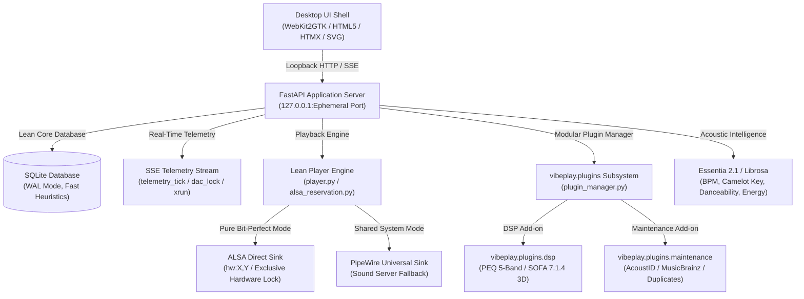

# vibeplay

[](https://github.com/defiqantcoder/vibeplay/actions)


> **Precision Audiophile Music Console & Lo-Fi Lounge for Linux (Ubuntu 24.04 LTS)**  
> Bit-perfect ALSA hardware reservation, dynamic DAC detection, 15 tactile Lo-Fi Lounge screens, modular add-on architecture, Camelot harmonic key mixing, and local natural-language smart playlists.

---

## 🌟 Core Highlights

- 🛡️ **Bit-Perfect Hardware Reservation (`hw:`) & PipeWire Fallback:** Direct hardware communication bypassing operating system resampling and mixers, with auto-fallback to PipeWire so audio never cuts out.
- 🎚️ **Strict Bit-Perfect Audio Integrity:** Enforces sample bit-perfection during direct ALSA streaming (`hw:X,Y`) by completely bypassing EQ and software volume processing, with a 1-click switcher to DSP mode when tone shaping is desired.
- ☕ **15-View Lo-Fi Lounge Interface:** Complete tactile desktop suite featuring a responsive Boombox capsule transport bar (docked flush on standard displays, floating on high-DPI displays), Record Crate vinyl sleeve browser, sortable Master Table, and dedicated turntable Fullscreen Now-Playing mode with 60fps canvas visualizer.
- 🎛️ **Natural-Language & Guided Smart Playlists:**
  - **Natural-Language Prompting:** Type common-language prompts like *"chill lofi study vibes"*, *"high energy workout"*, or *"dance party around 125 bpm"* to instantly query your collection via local rule-based heuristics without cloud or LLM overhead.
  - **Guided 4-Step Architect:** Seed track picker, energy arc curves (`Energy Ramp`, `Peak-Hour Wave`, `Steady Pulse`, `Late Night Chill`), live Camelot harmonic key transition scoring (1.0, 0.95, 0.70, 0.50, 0.20), and native HTML5 drag-and-drop track reordering.
- 🧩 **Modular Add-on / Plugin Subsystem:** Clean separation between the lean audio core and optional features via `vibeplay.plugins`:
  - `vibeplay.plugins.dsp`: Sound DSP & Acoustics Convolver (5-band PEQ with interactive SVG curve and SOFA 7.1.4 HRTF binaural spatial convolution).
  - `vibeplay.plugins.maintenance`: Library Maintenance & Quality Tools (duplicate detection and MusicBrainz/AcoustID metadata enrichment).
  - **Add-on Toybox:** GUI dialog in the titlebar and preferences to inspect installed plugins and toggle their activation.
- 🔍 **Track Inspector & Real-Time Telemetry:** Acoustic inspection deck featuring Camelot harmonic key wheels, tempo, LUFS loudness, 7 heuristic mood bars, and a live Server-Sent Events (SSE) telemetry deck (SVG oscilloscope, 9-segment VU headroom meter, DMA ring buffer status).
- 🎨 **"God of Ink" Design System:** 9 audiophile dark theme presets (`God of Ink`, `Wine / Uncut Amethyst`, `Obsidian / Lavender`, `Swimming with the Whales`, `Mint City`, `Slate Audiophile`, `Beyond the Boundary`, `The Unknown`, `Castle In The Sky`) adhering strictly to WCAG 2.1 contrast standards with zero hardcoded CSS colors and session persistence.
- 🔒 **Security Invariants:** Loopback-only binding (`127.0.0.1` / `localhost`), ephemeral IPC session tokens, and atomic settings storage with `chmod 600` permissions.

---

## 🖥️ The 15 Lo-Fi Lounge Views & Components

| View / Component | Shortcut / Trigger | Description |
| :--- | :--- | :--- |
| **Boombox Capsule** | Bottom Bar | Responsive transport footer docking flush on standard displays and expanding into a floating capsule on high-DPI displays with scrub timeline and quick modal triggers. |
| **Record Crate** | View Switcher (`📦`) | Flip through vinyl sleeves with peeking vinyl discs, mood filters, and 1-click playback. Persisted across sessions in `localStorage`. |
| **Master Table** | View Switcher (`📋`) | Precision sortable library table with clickable column headers (Artist, Album, Title, BPM, Key, Energy, Danceability, Duration) and right-click context menu. |
| **Fullscreen Now-Playing** | <kbd>F8</kbd> / `⛶` Button | Dedicated full-window turntable view featuring rotating vinyl animation, acoustic metadata badges, technical stream indicators, and a real-time 60fps audio visualizer. |
| **EQ Studio** | `EQ` Button | 5-band parametric equalizer with interactive SVG frequency response curve and headroom margin. Fully honors pure bit-perfect ALSA bypass with 1-click routing to DSP mode. |
| **Track Inspector** | `Inspect` Button | Deep acoustic analysis deck featuring Camelot harmonic key wheels, tempo, LUFS loudness, and 7 heuristic mood bars. |
| **Playlist Builder** | <kbd>F7</kbd> / `Vibe Builder` | Natural language search prompt and 4-step guided wizard with energy arcs, harmonic badges, and drag-and-drop reordering. |
| **Add-on Toybox** | `Toybox` Button | Inspect installed add-ons, toggle active plugins, and review system hooks. |
| **Sound Output Switcher** | `Output` Button | Popover for smart DAC discovery, listing available ALSA direct hardware endpoints (`hw:X,Y`) and PipeWire sinks with 1-click live switching. |
| **DAC Alert Modal** | Automatic | Automatic failover warning modal if a USB DAC is unplugged during playback, offering 1-click reconnection and PipeWire fallback. |
| **Keyboard Shortcuts** | <kbd>?</kbd> / Help Menu | Comprehensive cheatsheet displaying all studio shortcuts and hotkeys. |
| **Track Context Menu** | Right-Click on Row | Quick actions: Play Now, Play Next, Add to Queue, Inspect Track, or Show File in Folder. |
| **Onboarding Wizard** | First Launch / Menu | Welcome dialog with native directory picker to select and index your music folder on first start. |
| **Settings & Themes** | <kbd>Ctrl</kbd> + <kbd>,</kbd> | Preferences dialog with 4 tabs: ALSA Hardware Transport, Add-on Toybox, Essentia Extraction, and Theme Palette Picker. |
| **HUD Telemetry Deck** | Top Dashboard | Live SVG oscilloscope, segmented headroom meter, harmonic wheel, and acoustic cluster distribution histogram. |

---

## 🚀 Installation & Getting Started

### Method 1: Install Debian Package (Recommended for Ubuntu 24.04 LTS)

Download the latest `.deb` package from [GitHub Releases](https://github.com/defiqantcoder/vibeplay/releases/latest) or install locally:

```bash
# Install the Debian package (includes standalone binary, .desktop launcher, icons, and systemd service)
sudo apt install ./dist/vibeplay_0.2.0_amd64.deb --reinstall
# or using dpkg:
sudo dpkg -i dist/vibeplay_0.2.0_amd64.deb

# Launch from your desktop app menu or run:
vibeplay-desktop
```

### Method 2: User-Space Install (No `sudo` Required)

If you don't have root privileges or want to install strictly into your user environment (`~/.local`):

```bash
# 1. Clone repository
git clone https://github.com/defiqantcoder/vibeplay.git
cd vibeplay

# 2. Run the user-space installer
bash scripts/install-desktop.sh

# 3. Launch from your application menu or terminal
vibeplay-desktop
```

### Method 3: Run from Source with `uv` (Live Development)

For fast iteration without rebuilding native binaries:

```bash
# 1. Install system prerequisites
sudo apt update && sudo apt install -y ffmpeg libsndfile1 libchromaprint-tools mpd

# 2. Install Astral uv (fast Python package manager)
curl -LsSf https://astral.sh/uv/install.sh | sh

# 3. Clone and sync dependencies
git clone https://github.com/defiqantcoder/vibeplay.git
cd vibeplay
uv sync

# 4. Launch Desktop Application
uv run vibeplay-desktop

# (Tip: Use --browser to launch in a standard web browser with developer tools)
uv run vibeplay-desktop --browser
```

---

## 🎹 Studio Keyboard Shortcuts

| Shortcut | Description | Action |
| :--- | :--- | :--- |
| <kbd>Space</kbd> / <kbd>F9</kbd> | Play / Pause | Toggle active audio playback |
| <kbd>F10</kbd> | Previous Track | Skip to previous queued track |
| <kbd>F11</kbd> | Next Track | Skip to next queued track |
| <kbd>F8</kbd> | Fullscreen Turntable | Toggle fullscreen now-playing view with 60fps visualizer |
| <kbd>Ctrl</kbd> + <kbd>O</kbd> | Open Files / Library | Open local file or music folder dialog |
| <kbd>Ctrl</kbd> + <kbd>,</kbd> | Preferences / DSP | Open Verbose Hardware & DSP dialog |
| <kbd>Ctrl</kbd> + <kbd>R</kbd> | Rescan Library | Refresh music library and extract tags |
| <kbd>Ctrl</kbd> + <kbd>Q</kbd> | Quit Application | Safely tear down MPD and close window |
| <kbd>F5</kbd> | Master Console | Switch to Library Master Console |
| <kbd>F7</kbd> | Playlist Builder | Switch to Natural Language & Guided Playlist Builder |
| <kbd>?</kbd> | Shortcuts Cheatsheet | Open keyboard shortcuts help modal |
| <kbd>Esc</kbd> | Dismiss Overlays | Close active modal, dialog, or popover |

---

## 💻 CLI Commands Reference

`vibeplay` provides a complete command-line interface for headless automation, background indexing, and diagnostic audits:

```bash
# Scan a music directory recursively and index audio files
uv run vibeplay scan /path/to/your/music

# Fingerprint tracks with AcoustID and enrich with MusicBrainz metadata (via maintenance plugin)
uv run vibeplay enrich

# Extract rhythm, key, BPM, and mood features using Essentia
uv run vibeplay analyze

# Generate smart playlists using local rule heuristics
uv run vibeplay playlist --name "Chill Evening" --vibe chill
uv run vibeplay playlist --name "Energy Workout" --arc peak

# Export playlist to file (m3u, m3u8, json, csv)
uv run vibeplay export 1 --format m3u8

# Detect library duplicates by AcoustID and acoustic similarity (via maintenance plugin)
uv run vibeplay duplicates

# Control playback from terminal
uv run vibeplay control play
uv run vibeplay control pause
uv run vibeplay control next

# Check system capabilities and optional dependencies
uv run vibeplay doctor

# Run automated release gate validation (loopback, permissions, themes, templates)
uv run vibeplay desktop --release-gate
```

---

## 🏗️ Architecture Overview



---

## 🧪 Testing & Validation

Run the test suite via `pytest`:

```bash
# Run all regression tests
uv run pytest

# Run with test coverage report
uv run pytest --cov=src/vibeplay --cov-report=term-missing

# Run release gate audit
uv run vibeplay desktop --release-gate
```

---

## 📄 License

Distributed under the **MIT License**. See `LICENSE` for more information.
