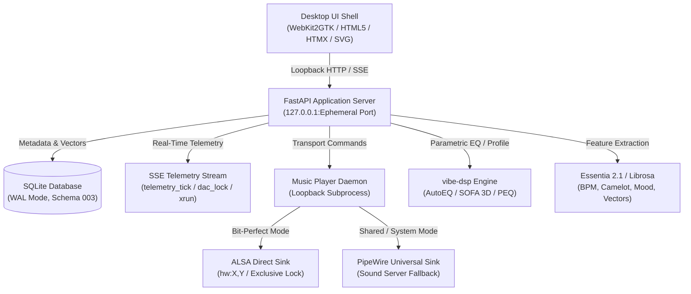

# vibeplay

[](https://github.com/defiqantcoder/vibeplay/actions)


> **Audiophile Precision Music Player & Acoustic Intelligence Suite for Linux (Ubuntu 24.04)**
> Direct bit-perfect ALSA hardware reservation, real-time audio telemetry visualizers, Camelot harmonic key mixing, unsupervised acoustic clustering, and a native desktop studio experience.

---

## 🌟 Core Highlights

- 🛡️ **Bit-Perfect Hardware Reservation (`hw:`) & PipeWire Fallback:** Direct hardware communication bypassing operating system resampling and mixers, with auto-fallback to PipeWire so audio never cuts out.
- ⚡ **Real-Time Telemetry Deck:** Live Server-Sent Events (SSE) telemetry feeding a responsive SVG oscilloscope, 9-segment VU headroom meter, live Camelot harmonic sync wheel, and acoustic cluster distribution histogram.
- 🎛️ **4-Step Guided Smart Playlist Builder:**
  1. **Seed Track Picker:** Real-time search across library tracks with live BPM and Camelot notation.
  2. **Vibe Trajectories & Moods:** 15 distinct moods (`Chill`, `Energetic`, `Melancholic`, `Euphoric`, `Deep Focus`, `Dark & Intense`, `Ambient`, `Lo-Fi`, `Driving`, etc.) and energy curve arcs (`Energy Ramp`, `Peak-Hour Wave`, `Steady Pulse`, `Late Night Chill`).
  3. **Harmonic Transition Preview:** Automatic evaluation of Camelot key transitions (energy boosts, relative majors/minors, harmonic shifts, tempo deltas).
  4. **HTML5 Native Drag-and-Drop Reordering:** Live recalculation of sequence transition scores on drop.
- 🎨 **"God of Ink" Design System:** 6 audiophile dark themes (`God of Ink`, `Wine / Uncut Amethyst`, `Obsidian / Lavender`, `Swimming with the Whales`, `Mint City`, `Slate Audiophile`) adhering to WCAG 2.1 contrast standards with zero hardcoded CSS colors.
- 🧠 **Local-First & Machine Learning Driven:** Acoustic feature extraction using Essentia 2.1 and Librosa (BPM, Key, Scale, Loudness, Danceability, Moods, and Audio Embeddings). Track clusters modeled with K-Means and HDBSCAN, fully cached in-memory.
- 🔒 **Desktop Security Invariants:** Loopback-only binding (`127.0.0.1` / `localhost`), ephemeral IPC session tokens, and atomic settings storage with `chmod 600` permissions.

---

## 🚀 Installation & Getting Started

### Option A: Install Debian Package (Recommended for Ubuntu 24.04)

Download or build the standalone Debian package:

```bash
# 1. Download or build the .deb package
./scripts/build-deb.sh

# 2. Install the package
sudo dpkg -i dist/vibeplay_0.1.0_amd64.deb

# 3. Launch from your desktop application launcher or terminal
vibeplay desktop
```

### Option B: Run from Source with `uv`

Ensure Python 3.12, `uv`, and multimedia system libraries are installed:

```bash
# 1. Install system prerequisites
sudo apt update && sudo apt install -y ffmpeg libsndfile1 libchromaprint-tools mpd

# 2. Install Astral uv (fast Python package manager)
curl -LsSf https://astral.sh/uv/install.sh | sh

# 3. Clone and sync dependencies
git clone https://github.com/defiqantcoder/vibeplay.git
cd vibeplay
uv sync

# 4. Launch Desktop Application
uv run vibeplay desktop
```

---

## 🎹 Studio Keyboard Shortcuts

| Shortcut | Description | Action |
| :--- | :--- | :--- |
| <kbd>Space</kbd> / <kbd>F9</kbd> | Play / Pause | Toggle active playback |
| <kbd>F10</kbd> | Previous Track | Skip to previous queued track |
| <kbd>F11</kbd> | Next Track | Skip to next queued track |
| <kbd>Ctrl</kbd> + <kbd>O</kbd> | Open Files / Library | Open local file or music folder |
| <kbd>Ctrl</kbd> + <kbd>,</kbd> | Preferences / DSP | Open Verbose Hardware & DSP Popover |
| <kbd>Ctrl</kbd> + <kbd>R</kbd> | Rescan Library | Refresh music library and metadata |
| <kbd>Ctrl</kbd> + <kbd>Q</kbd> | Quit Application | Safely tear down MPD and close window |
| <kbd>F5</kbd> | Master Console | Switch to Library Master Console |
| <kbd>F6</kbd> | Acoustic Clustermap | Switch to Vibe Clusters View |
| <kbd>F7</kbd> | Energy Architect | Switch to Guided Playlist Builder |
| <kbd>Esc</kbd> | Dismiss Overlays | Close active modal, dialog, or popover |

---

## 💻 CLI Commands Reference

`vibeplay` provides a complete command-line interface for headless automation, background indexing, and batch processing:

```bash
# Scan a music directory recursively and index audio files
uv run vibeplay scan /path/to/your/music

# Fingerprint tracks with AcoustID and enrich with MusicBrainz metadata
uv run vibeplay enrich

# Extract rhythm, key, BPM, and mood features using Essentia
uv run vibeplay analyze

# Compute unsupervised acoustic clusters (K-Means / HDBSCAN)
uv run vibeplay clusters

# Generate smart playlists from CLI
uv run vibeplay playlist --name "Chill Evening" --vibe chill
uv run vibeplay playlist --name "Energy Workout" --arc peak

# Export playlist to format (m3u, m3u8, json, csv)
uv run vibeplay export 1 --format m3u8

# Detect duplicates by AcoustID and acoustic similarity
uv run vibeplay duplicates

# Run automated release gate validation checks
uv run vibeplay desktop --release-gate
```

---

## 🏗️ Architecture Overview



---

## 🧪 Testing & Validation

Run the test suite via `pytest`:

```bash
# Run all unit and integration tests
uv run pytest

# Run with test coverage report
uv run pytest --cov=src/vibeplay --cov-report=term-missing

# Run release gate audit (validates loopback, permissions, themes, and templates)
uv run vibeplay desktop --release-gate
```

---

## 📄 License

Distributed under the **MIT License**. See `LICENSE` for more information.
